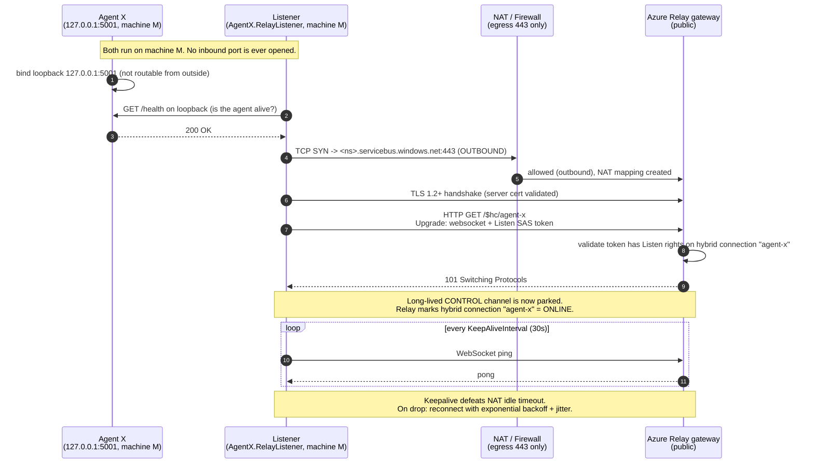
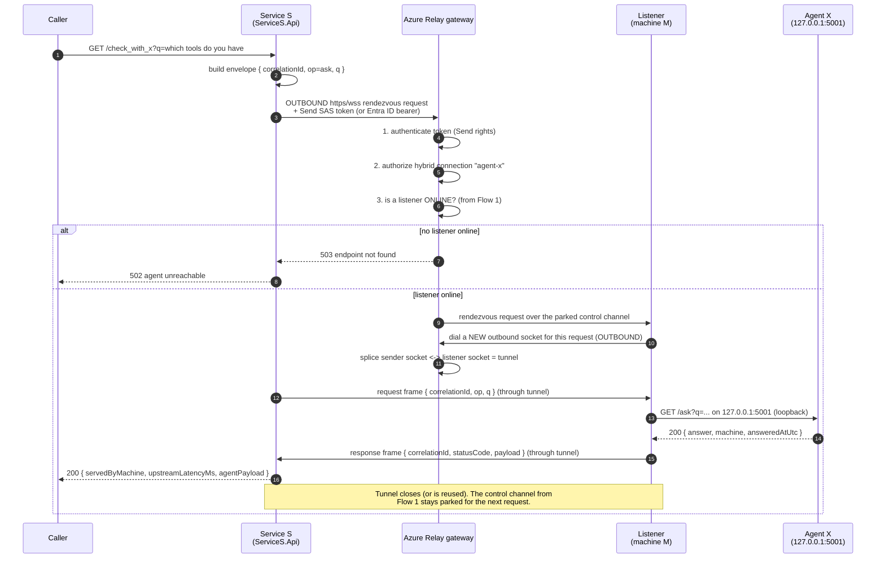

# agent-through-web-socket

Reaching an AI agent that lives on a machine nobody can dial into.

## 1. Problem statement

| Fact | Consequence |
| --- | --- |
| AI **Agent X** runs as a service on **machine M** (`https://localhost:5001`) | Only processes on machine M can call it |
| Machine M is **not inbound reachable** (NAT, corporate firewall, no public IP, no port forwarding) | Nobody can open a TCP connection *to* machine M |
| Machine M **can** create **outbound** connections (ports 443 open for egress) | Machine M can connect *out* to the internet |
| Another service **Service S** wants Agent X's output | It needs a path that machine M builds from the inside |

Classic NAT traversal problem: the side that owns the data cannot be addressed, so the
connection has to be established **in the opposite direction of the data flow**.

## 2. Solution

Machine M dials **out** to a publicly reachable **rendezvous point** and parks a
long-lived WebSocket there. Service S then talks to that rendezvous point. The
rendezvous point splices the two outbound connections into one bidirectional tunnel.

In Azure this rendezvous point is **[Azure Relay – Hybrid Connections](https://learn.microsoft.com/en-us/azure/azure-relay/relay-what-is-it)**:

* Machine M runs a **listener** that opens a WebSocket to `wss://<ns>.servicebus.windows.net/$hc/<connection>` using a **Listen**-only token.
* Service S is a **sender** that asks the relay for a rendezvous using a **Send**-only token (or a Microsoft Entra ID identity).
* The relay only connects the two if the token is valid **and** a listener is online. Machine M never opens a listening port.

```
         (no inbound possible)                        (public endpoint)
  +-------------------------------+              +------------------------+              +------------------+
  |  Machine M (behind NAT)       |              |   Azure Relay          |              |   Service S      |
  |                               | --outbound-> |   namespace            | <--outbound--|  (another agent) |
  |  Agent X  127.0.0.1:5001      |   wss:443    |   hybrid connection    |    https:443 |  /check_with_x   |
  |  Listener (outbound only)     |              |   "agent-x"            |              |                  |
  +-------------------------------+              +------------------------+              +------------------+
                                                   ^ validates SAS / Entra ID
                                                   ^ matches sender <-> listener
```

## 3. Flow 1 — handshake: machine M sets up the socket

Machine M registers itself with the relay *before* any caller exists. This is the only
step that makes it addressable, and it is 100% outbound.



**What the handshake buys us:** the relay now holds one end of a socket whose other end
is inside machine M's network. Any future request can be *pushed down* that socket
instead of being dialled *into* machine M.

## 4. Flow 2 — request: Service S → Agent X → back



### How security is handled

| Layer | Mechanism |
| --- | --- |
| Transport | TLS on every hop; relay certificate validated by both sides |
| Listener identity | SAS rule with **Listen** rights only, or managed identity with the *Azure Relay Listener* role — it can never send |
| Sender identity (Service S) | SAS rule with **Send** rights only, or a Microsoft Entra ID identity / managed identity approved on the namespace. `TokenProvider.CreateManagedIdentityTokenProvider()` is used when `Relay:UseEntraId = true` |
| Token placement | SAS goes in the `ServiceBusAuthorization` header or `sb-hc-token` query param during the *handshake*. It is validated at the relay edge **before** any byte reaches machine M |
| Attack surface on machine M | Zero listening ports exposed. Agent X binds loopback only; the one process that can reach it is the listener |
| Token lifetime | Short-lived (`Relay:TokenLifetime`, default 20 min) and refreshed, so a leaked token expires quickly |
| Correlation | Every envelope carries a `correlationId`, so replies are matched and stray frames are rejected |

### Networking concepts used in this project

* **NAT traversal via reverse connection** — the data consumer never initiates toward the data owner.
* **HTTP/1.1 `Upgrade: websocket` (RFC 6455)** — one HTTP request becomes a persistent full-duplex byte stream, which is why it passes proxies and firewalls that only allow 443.
* **Loopback-only binding** — `ListenLocalhost(5001)` makes Agent X unroutable from any other host.
* **Frames vs. messages** — each envelope is one WebSocket text frame; fragmented frames are reassembled using the `EndOfMessage` flag.
* **Multiplexing + correlation** — many Service S requests share one tunnel; a `correlationId` → `TaskCompletionSource` map routes replies back to the right caller, and a write lock prevents interleaved frames.
* **Keepalive (ping/pong)** — keeps NAT mappings and relay idle timers alive.
* **Reconnect with exponential backoff + jitter** — TCP connections die; a fleet of machines must not reconnect in lockstep.
* **Timeouts and backpressure** — dispatch waits 30s, then returns `504` instead of leaking a pending request.

## 5. Project layout

```
agent-through-web-socket/
├── agent-through-web-socket.sln
└── src/
    ├── Relay.Shared/            # envelopes (AgentRequest/AgentResponse), RelayOptions, SAS token generator
    ├── AgentX.Service/          # dummy AI Agent X, loopback-only: /get_ai_tools, /ask?q=, /health
    ├── AgentX.RelayListener/    # runs on machine M: outbound listener + loopback forwarder
    │                            #   AzureRelayListenerWorker  -> real Azure Relay hybrid connection
    │                            #   LocalSocketListenerWorker -> offline WebSocket mode
    ├── LocalWebSocketBroker/    # stand-in for the relay gateway so the flows run with no Azure subscription
    └── ServiceS.Api/            # Service S: /check_with_x?q=..., /check_with_x/tools
```

### Endpoints

| Component | Endpoint | Purpose |
| --- | --- | --- |
| Agent X (loopback, machine M) | `GET /get_ai_tools` | dummy tool catalogue |
| Agent X | `GET /ask?q=` | dummy inference |
| Agent X | `GET /health` | liveness |
| Broker (relay stand-in) | `GET /listen` | WebSocket upgrade — Flow 1, needs `X-Relay-Secret` |
| Broker | `POST /dispatch` | push an envelope through the tunnel — Flow 2, needs `X-Relay-Send-Key` |
| Service S | `GET /check_with_x?q=` | ask Agent X through the tunnel |
| Service S | `GET /check_with_x/tools` | fetch Agent X's tool list through the tunnel |
| Service S | `GET /check_with_x/health` | probe Agent X through the tunnel |

## 6. Run it

### Offline mode (default, no Azure needed)

Four terminals, in this order:

```bash
dotnet dev-certs https                                    # once: loopback cert for Agent X

dotnet run --project src/LocalWebSocketBroker             # relay stand-in  :7000
dotnet run --project src/AgentX.Service                   # Agent X         :5001 (loopback only)
dotnet run --project src/AgentX.RelayListener             # Flow 1: dials out and parks the tunnel
dotnet run --project src/ServiceS.Api                     # Service S       :6000
```

Then drive Flow 2:

```bash
curl "http://localhost:6000/check_with_x?q=which tools do you have"
curl "http://localhost:6000/check_with_x/tools"
curl "http://localhost:7000/"          # {"role":"relay-gateway-stand-in","tunnelOnline":true}
```

Sample response (`servedByMachine` proves the work happened on machine M):

```json
{
  "correlationId": "32b3abf66d81432c9cb5fb0ad386d41b",
  "viaTunnel": true,
  "servedByMachine": "machine-m",
  "upstreamLatencyMs": 4,
  "agentStatusCode": 200,
  "agentPayload": "{\"agent\":\"agent-x\",\"answer\":\"Agent X processed '...' locally...\"}"
}
```

### Azure Relay mode

```bash
az relay namespace create   -g <rg> -n <ns> --sku Standard
az relay hyco create        -g <rg> --namespace-name <ns> -n agent-x --requires-client-authorization true
az relay hyco authorization-rule create -g <rg> --namespace-name <ns> --hybrid-connection-name agent-x -n listen-only --rights Listen
az relay hyco authorization-rule create -g <rg> --namespace-name <ns> --hybrid-connection-name agent-x -n send-only   --rights Send
```

Set `Mode=AzureRelay` on both the listener and Service S and fill in the `Relay` section
(`Namespace`, `ConnectionName`, `KeyName`, `Key`), or set `Relay:UseEntraId=true` and
assign *Azure Relay Listener* / *Azure Relay Sender* roles to the two managed identities.
Use environment variables or a secret store — never commit keys.

```bash
Mode=AzureRelay Relay__Namespace=<ns>.servicebus.windows.net Relay__KeyName=listen-only Relay__Key=<key> \
  dotnet run --project src/AgentX.RelayListener
```

## 7. Status / known limitations

* The offline (`LocalBroker`) path is verified end to end: handshake, dispatch, loopback call, correlated reply, and `401` on a wrong key.
* The `AzureRelay` path compiles against `Microsoft.Azure.Relay` 3.1.1 but has not been run against a live namespace — it is reference code for the architecture.
* The broker stand-in holds a single listener tunnel (one machine M). Production would key tunnels by hybrid-connection name, which is what Azure Relay does for you.
* Dev-only shortcut: the listener accepts Agent X's self-signed loopback certificate.
