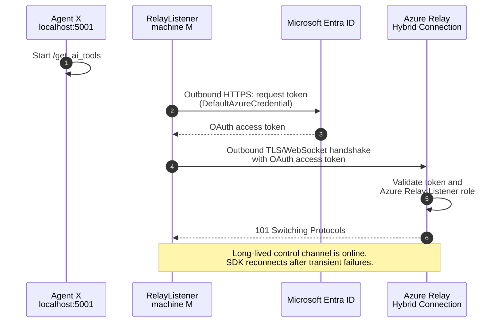
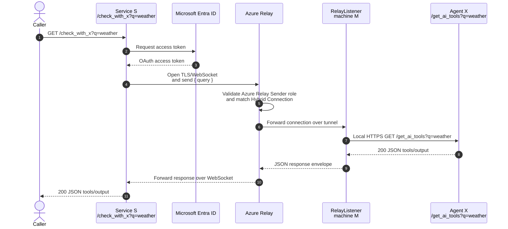

# Agent through WebSocket

A small .NET 10 sample that lets **Service S** call **Agent X** on a machine that cannot accept inbound network connections. The machine creates an outbound TLS WebSocket to an Azure Relay Hybrid Connection; Azure Relay then acts as the public rendezvous point.

## Components

| Project | Runs where | Responsibility |
|---|---|---|
| `AgentX` | Private machine M | Dummy AI API: `GET /get_ai_tools?q=...` on `https://localhost:5001` |
| `RelayListener` | Private machine M | Maintains the outbound Relay listener and proxies allowed requests to Agent X |
| `ServiceS` | Any permitted network | Exposes `GET /check_with_x?q=...` and sends requests through Relay |
| `AgentThroughWebSocket.Shared` | Both sides | Relay authentication, URI configuration, and JSON-line wire protocol |

There is no inbound firewall rule, NAT port-forward, or public address on machine M. Both Relay participants initiate outbound connections, normally over TCP 443. Relay forwards bytes; it does not expose Agent X directly.

## Flow 1: listener handshake and tunnel setup



Machine M initiates every network connection. The WebSocket upgrade changes an HTTPS connection into a full-duplex channel, while TLS provides encryption in transit and server authentication.

## Flow 2: Service S request to Agent X and back



The sample opens one data connection per request. Azure Relay uses the listener's existing control channel to rendezvous the sender with machine M, then carries the bidirectional request/response stream.

## Security design

**Recommended: Microsoft Entra ID and least-privilege RBAC**

- Give the identity on machine M **Azure Relay Listener** on only the `agent-x` Hybrid Connection.
- Give Service S **Azure Relay Sender** on only that Hybrid Connection.
- `DefaultAzureCredential` supports managed identity in Azure and developer credentials locally. No credential is stored in source.
- Relay traffic is TLS encrypted. Keep Agent X on loopback and use HTTPS so the final local hop is also encrypted.
- The listener constructs only `/get_ai_tools`; callers cannot supply an arbitrary URL. This prevents the listener from becoming an SSRF/open-proxy endpoint.

**Fallback: Shared Access Signature (SAS)**

Create separate Relay policies: one with `Listen` for `RelayListener`, and one with `Send` for `ServiceS`. Set `AzureRelay__Authentication=Sas`, `AzureRelay__SasKeyName`, and `AzureRelay__SasKey` in a secret store or environment. Never commit keys or use `RootManageSharedAccessKey` in an application.

This sample authenticates Service S to Relay, not callers to Service S. A production deployment must also protect `/check_with_x` (for example with OAuth), validate/limit input, apply timeouts and rate limits, and avoid logging sensitive prompts or outputs.

## Azure setup

Create a Relay namespace and a Hybrid Connection named `agent-x` in the Azure portal. Do **not** enable client authorization bypass. Then assign the listener and sender roles at the Hybrid Connection resource scope.

For more background, see [What is Azure Relay?](https://learn.microsoft.com/azure/azure-relay/relay-what-is-it), [Hybrid Connections WebSockets in .NET](https://learn.microsoft.com/azure/azure-relay/relay-hybrid-connections-dotnet-get-started), and [Microsoft Entra authentication for Azure Relay](https://learn.microsoft.com/azure/azure-relay/authenticate-application).

## Configure

The same settings exist in `RelayListener/appsettings.json` and `ServiceS/appsettings.json`. Override them without editing files:

```bash
export AzureRelay__Namespace="my-relay.servicebus.windows.net"
export AzureRelay__HybridConnectionName="agent-x"
export AzureRelay__Authentication="EntraId"
```

For local Entra authentication, sign in with `az login`, or set the standard `AZURE_TENANT_ID`, `AZURE_CLIENT_ID`, and `AZURE_CLIENT_SECRET` variables for a service principal. Managed identity needs no secret variables.

Trust a local development certificate before using the documented HTTPS URL:

```bash
dotnet dev-certs https --trust
```

## Build, test, and run

```bash
cd agent-through-web-socket
dotnet build
dotnet test
```

Start each process in a separate terminal:

```bash
# On private machine M
dotnet run --project src/AgentX --urls https://localhost:5001
dotnet run --project src/RelayListener

# On the Service S host
dotnet run --project src/ServiceS --urls http://localhost:5002
```

Call the public-facing sample endpoint:

```bash
curl "http://localhost:5002/check_with_x?q=which-tools-are-available"
```

Expected shape:

```json
{
  "agent": "Agent X",
  "query": "which-tools-are-available",
  "tools": ["search", "summarize", "reason"],
  "generatedAtUtc": "2026-10-28T20:18:37Z"
}
```

An Azure Relay resource and valid identities/keys are required for the end-to-end path. Unit tests cover the local wire protocol and connection URI normalization without Azure access.
